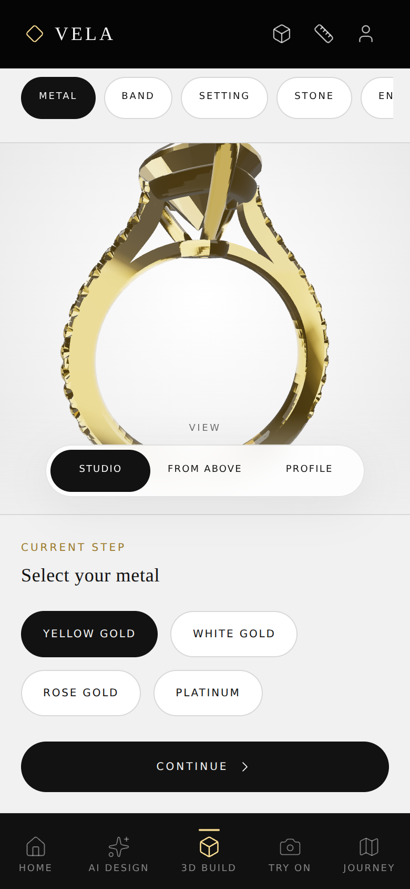
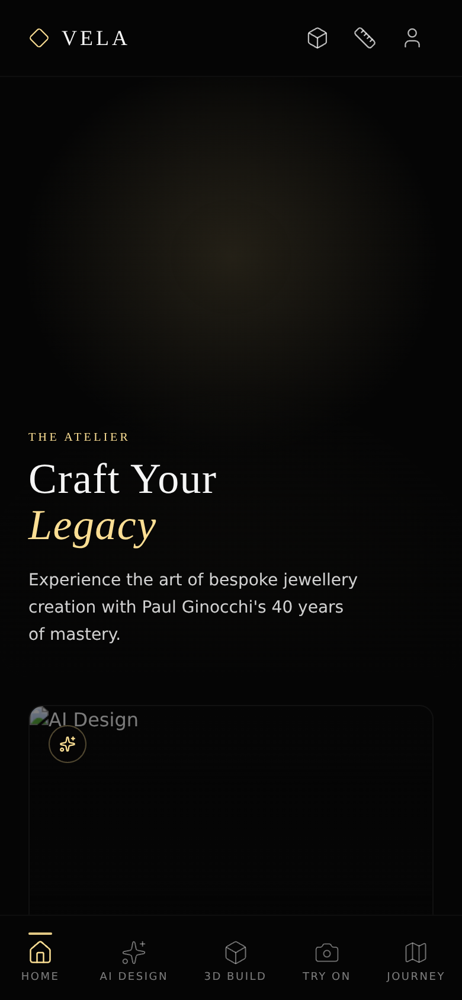

# Vela Concierge — Visual & Technical Screen Audit

**Date:** 2026-07-14 · **Viewport tested:** 390 × 844 (iPhone-class), headless Chromium, all 9 routes.

## TL;DR

The app was not "badly designed and squashed" — it was **shipping with zero CSS**. The stylesheet failed to compile, Vite returned a 500 for `index.css`, and every screen fell back to unstyled HTML in default document flow. That is why everything looked like plain text stacked on one screen. On top of that, the 3D configurator ("customize your own") had two real defects of its own. All three blocking issues are fixed in this branch.

---

## Blocking defects (fixed in this branch)

### 1. App-wide: stylesheet failed to compile → every screen unstyled

- **Symptom:** every route renders as raw HTML (the "squashed into one simple screen" report).
- **Root cause:** `src/index.css` used `@apply lux-ui` / `@apply lux-display` inside `.lux-kicker`, `.lux-page-title`, `.lux-page-lede`, and `.lux-chip`. In Tailwind v4, `@apply` only accepts real utilities; `.lux-ui` and `.lux-display` were plain classes in `@layer utilities`, so Tailwind aborted the whole build: `Cannot apply unknown utility class 'lux-ui'`. Vite then served a 500 for the stylesheet and the error overlay on dev.
- **Fix:** registered `lux-ui` and `lux-display` with the `@utility` directive so they are first-class utilities, usable both in markup and with `@apply`.

### 2. Configurator: bottom half of the screen clipped and unreachable

- **Symptom:** on an 844 px-tall phone, the page content is 977 px tall inside a 779 px container with `overflow: hidden` — the metal/band/stone chips and the **Continue / Save to brief** button were cut off below the fold with no way to scroll to them. The core purchase flow was dead.
- **Root cause:** the page root used `overflow-hidden` while its three stacked sections (header ≈ 320 px + viewport ≥ min(52vh, 22rem) + options sheet ≈ 400 px) can never fit a phone viewport together.
- **Fix:** page root is now `overflow-y-auto`, matching the scroll behaviour of every other route. The 3D viewport keeps its minimum height; the options sheet scrolls into view.

### 3. Configurator: 3D canvas dies if a third-party CDN is unreachable

- **Symptom:** the whole canvas was replaced by the "Preview unavailable — refresh the page" error card.
- **Root cause:** `<Environment preset="studio" />` downloads `studio_small_03_1k.hdr` from a third-party CDN at runtime. Any network hiccup, ad-blocker, or CDN outage throws inside Suspense, trips `CanvasErrorBoundary`, and permanently kills the preview (the boundary has no retry).
- **Fix:** replaced the preset with a procedural `<Environment resolution={256}>` built from drei `<Lightformer>` softboxes (plus a warm gold ring light). Zero network requests, same studio-reflection look, canvas can no longer die from a fetch. Also pulled the hero camera back (`z 1.42 → 2.15`) so the full ring is framed instead of cropped at the viewport edges.

---

## Remaining risks & recommendations (not yet fixed)

Ordered by impact.

### Configurator (customize-your-own)

1. **4.5 MB FBX model** (`eternal-pear-ring-free-3d-jewelry-model.FBX`, plus an unused 4.5 MB `ring.fbx` and 12.8 MB `ring.obj` in `public/`). Convert to Draco-compressed glTF (~200–400 KB, `gltf-transform` or Blender export), delete the unused copies, and switch `FBXLoader` → `useGLTF`. This is the single biggest load-time win in the app.
2. **Engraving text loads a font from `fonts.gstatic.com` at render time** (`<Text font="https://fonts.gstatic.com/...">`, Configurator3D). Same class of fragility as the HDR; bundle a `.woff` in `public/` instead. Engraving position `[-0.2, 0.6, 0.9]` is also detached from the band — it floats in space rather than appearing engraved.
3. **Band/setting/shape changes are scale hacks** — "pavé" scales the band by 1.02, "oval/emerald" cuts squash the stone mesh. Visually the $400 pavé upgrade looks identical. Either source per-variant meshes or drop the options that can't be shown honestly; a luxury configurator that shows no difference after an upsell erodes trust.
4. **The step header is ~40% of the viewport** before the ring appears. Recommend collapsing the atelier back-link + kicker + lede into one row and moving the step chips into the options sheet, giving the 3D viewport the saved ~120 px.
5. **`estimatedPrice` derives stone price from a diamond/non-diamond binary** — emerald, sapphire, and ruby all cost +$1,800 flat and cut/shape is free. Fine for a prototype; flagging so pricing doesn't ship this way.
6. **Save is `localStorage` only** (`vela-ring-brief`) — nothing reads it back anywhere in the app. The Journey screen shows hardcoded demo data. Wiring the saved brief into Journey/Profile would close the demo loop.

### App shell

7. **Two dead files:** `src/pages/Dashboard.tsx`, `src/pages/AIGenerator.tsx`, and `src/components/BottomNav.tsx` + `src/components/Layout.tsx` are not imported by anything (App.tsx has its own `Navigation`/`Header`). Delete to stop them drifting.
8. **The splash screen plays on every route load** (it's mounted in `App`, gated only by component state). Persist a session flag so in-app navigation/reloads skip the 4-second intro.
9. **No 404 route** — unknown paths render an empty `<main>` between header and nav.

### Content/network fragility (all dark screens)

10. **Every image is hot-linked from Unsplash** (Home cards, Journey media, Jewellery Box pieces). One of the Jewellery Box URLs (`photo-1605100804763-247f66156ce4`) already 404s. With images blocked, Home's cards are black rectangles with alt text. Bundle the ~6 hero/card images into `public/` (they're the brand surface of the app) and add an `onError` fallback style for card images.
11. **`GEMINI_API_KEY` is compile-time injected into the client bundle** (`vite.config.ts` `define`). Anyone can extract it from the shipped JS. The AIDesign call also silently swallows failure — the spinner ends and nothing appears (no error state). Move generation behind a tiny server endpoint (the repo already ships `express`) and add an error message + retry in the UI.

### Visual polish (dark atelier screens are otherwise in good shape)

12. **Home hero is ~60vh of empty black** above the fold with only a faint radial glow — with the Unsplash images bundled, put a real hero image or the 3D ring render here; right now the first paint reads as "blank".
13. **Try-On is UI theatre** — "Detecting hand" is a static overlay; the capture/share buttons do nothing. Fine for a demo, but consider labelling it "Preview" so testers don't file it as broken.
14. **Ring sizer physical accuracy:** `diameter * 4` px assumes ~101 DPI; on a 3× iPhone the rendered circle is ~30% smaller than the stated mm. Calibrate with a credit-card overlay step (85.6 mm reference) or use `devicePixelRatio`-aware sizing; otherwise the tool gives wrong sizes and that's a costly wrong ring.
15. **Configurator light theme vs. app dark theme:** the jump from black atelier to `#f1f1f1` studio is defensible as a "workshop" metaphor, but the transition is abrupt inside a persistent black header/nav frame. Consider a 300 ms cross-fade on route enter, or tint the studio background warm (`#f4f1ea`) so the gold brand carries through.

---

## After screenshots

| Configurator (options sheet now reachable) | Home (after CSS fix) |
| --- | --- |
|  |  |

## Verification

- `npm run lint` (tsc --noEmit): clean.
- Playwright sweep of all 9 routes at 390×844: no page errors; configurator scroll container measured `scrollHeight 977 / clientHeight 779 / overflowY auto` and scrolls fully to the Continue button.
- Only remaining console noise is blocked external fetches (Google Fonts / Unsplash) in the sandboxed test environment — see recommendations 10–11.
